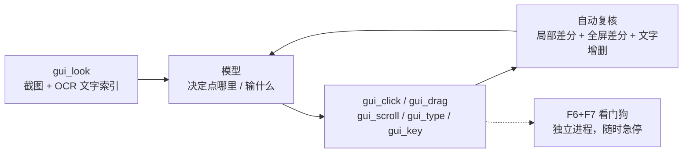
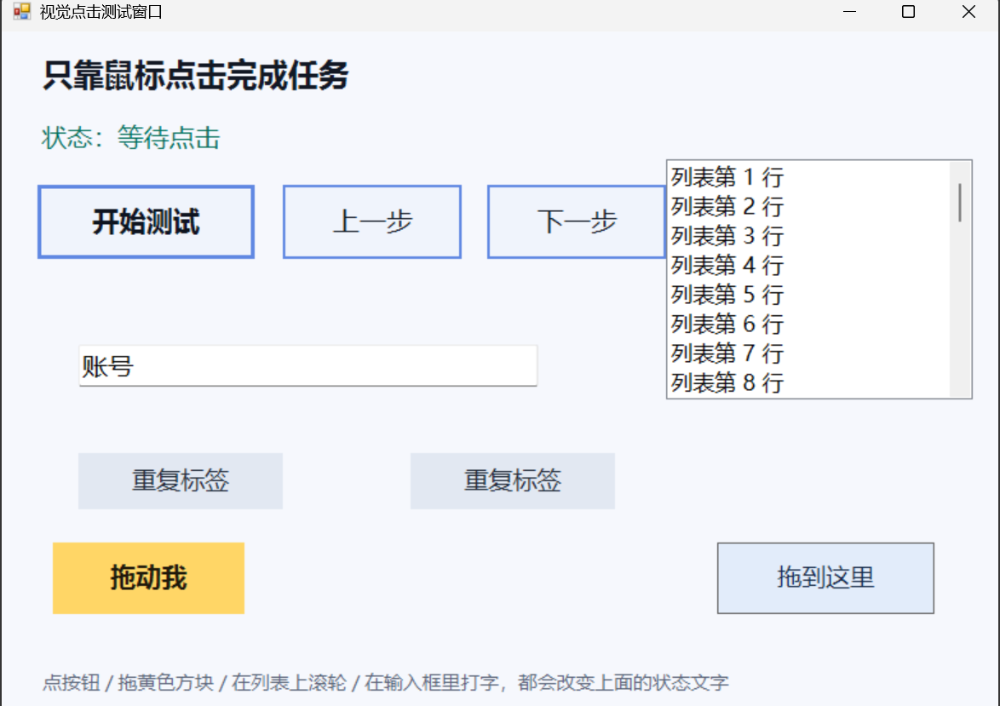

# dsh-vision-click

> 让 Agent 像人一样用**鼠标和键盘**操作 Windows：截图 → OCR 定位界面文字 → 真实点击/拖动/滚轮/输入 → 前后画面与文字双重复核。
> 不依赖任何视觉大模型 API，定位用 Windows 自带的 `Windows.Media.Ocr`（离线、约 200ms、中英双语）。

[](LICENSE)
[](#已知边界)
[](https://github.com/deepseek-ai)

**English TL;DR** — A DeepSeek Harness plugin that lets the agent drive Windows by sight: it screenshots the
active window, indexes every line of text with Windows OCR, clicks/drags/scrolls/types by **target text**
(or normalized coordinates), and verifies every action with a per-pixel diff plus an OCR text delta.
Emergency stop is F6+F7, watched by a separate process. Windows only, no API key, no vision model.

---

## 为什么需要它

纯像素 GUI Agent 最脆的一环是「把语义变成像素」：模型看缩略图估坐标，偏差几十像素，按钮就点空了。
这个插件把这件事做成确定性的能力：

- **定位**：OCR 给出真实包围盒，点击落在文字中心，误差为 0；
- **复核**：动作后自动比较画面与文字，明确告诉你「有反应 / 没有可测量的变化」；
- **兜底**：OCR 读不到时，仍可以用 `gui_look` 看图给 0~1 坐标；
- **安全**：F6+F7 由独立进程急停，看门狗不在就拒绝一切输入。

思路参考字节跳动 GUI Agent 那条路线（UI-TARS 的「截图 → 定位 → 动作 → 再截图」闭环、
Midscene 的「先拿到可点元素清单再决策」），但把「视觉大模型」换成了系统 OCR —— 更便宜、更快、完全离线。

## 工具

| 工具 | 作用 |
| --- | --- |
| `gui_look` | 截屏 + **文字索引**：识别活动窗口每一行文字，附 0~1 归一化中心坐标 |
| `gui_click` | 左/右/中键、单击/双击、`holdMs` 长按、`hover` 只悬停；按目标文字或坐标定位 |
| `gui_drag` | 按住拖动：`from` / `to` 各写目标文字或坐标（拖文件、滑块、框选、窗口） |
| `gui_scroll` | 滚轮：在目标文字/坐标处上下左右滚动 N 格 |
| `gui_type` | 键入文字：大小写、数字、中文、符号；`pressEnter` 输完回车 |
| `gui_key` | 组合键/功能键：enter、tab、esc、backspace、delete、方向键、f1-f12、`ctrl+a`、`shift+a`… |
| `gui_wait` | 等文字出现 / 消失（加载完成、弹窗关闭），比盲睡可靠 |
| `gui_do` | 一次执行一串步骤（点击/悬停/拖动/滚轮/键入/按键/等待，≤10 步），出错即停 |
| `gui_status` | 急停状态、看门狗、输入进程、OCR 是否可用 |
| `gui_rearm` | 急停之后重新武装（必须 `confirm: true`） |

一次典型交互：

```
gui_look  { query: "保存" }        → 「保存」在 (0.83, 0.06)
gui_click { target: "保存" }       → 点击 + 复核：新出现「已保存」
```

## 能做什么

| 动作 | 调用 |
| --- | --- |
| 左键单击 / 双击 | `gui_click {target:"确定"}` / `{..., count:2}` |
| 右键、中键 | `gui_click {target:"文件", button:"right"}` |
| 长按（按住不放再松开） | `gui_click {target:"…", holdMs:800}` |
| 悬停（触发 hover 菜单 / tooltip） | `gui_click {target:"…", hover:true}` |
| 按住拖动 | `gui_drag {from:{target:"a.txt"}, to:{target:"回收站"}}` |
| 滚轮上下 / 左右 | `gui_scroll {target:"列表", direction:"down", amount:5}` |
| 键入文字（含大小写/中文） | `gui_type {text:"Abc123"}` |
| 输完回车（搜索 / 提交） | `gui_type {text:"关键词", pressEnter:true}` |
| 大写字母 / 组合键 | `gui_key {keys:"shift+a"}` / `{keys:"ctrl+shift+s"}` |
| 删除 / 退格 / 方向键 | `gui_key {keys:"delete"}`、`{keys:"backspace", count:3}`、`{keys:"tab"}` |

实现细节：

- **键入走 Unicode 注入**（`SendInput` + `KEYEVENTF_UNICODE`）：字符按字面发送，`"AbC"` 就是 AbC、中文直接进、
  不受 CapsLock 与输入法状态影响，也不会切走用户当前的输入法；组合键才走虚拟键。
- **拖动不是瞬移**：按下 → 分步移动（默认 16 步 / 每步 12ms）→ 停 120ms → 松开；
  任何异常都会先松开鼠标键（`try/finally`），不会留下按住的左键。

## 工作流程



## 复核：动作到底有没有生效

每次动作后自动做三件事：

1. **局部像素差分**：以落点为中心（点击 ±240px、拖放 ±320px、滚动 ±420px）逐像素比较
   （C# `LockBits`，约 40ms），报告「落点附近是否变化、变化了多少格、变化区域在哪」。
2. **全屏差分**：有些操作的效果出现在别处（状态栏、提示条），全屏差分兜底。
3. **文字增删**：动作前后各做一次 OCR，报告「新出现」「消失」的文字 —— 例如
   `新出现：已保存；消失：保存中`。时钟、纯数字这类噪声会被过滤。

结论明确写成「有反应 / 没有可测量的变化」。没反应时不要连点同一处，先 `gui_look` 看新画面。

## 识别策略（为什么它认得出来）

Windows OCR 在整屏 2560×1600 上很不稳定：小字会被合并成一行（`网易有道翻译 MATLAB`）甚至整块丢失。
所以定位按下面的顺序退让，命中即停：

1. **活动窗口**整窗；
2. 同一窗口切成三条**横向条带**（很多控件在整窗里会被当作段落忽略，切条带后就能读到）；
3. **整个屏幕**；
4. 屏幕四块重叠**瓦片**（1.5 倍放大）。

同一行里还会额外尝试**词级片段**（1~4 个词的组合）：OCR 经常把相邻按钮并成一行，
行中心会落在两个按钮之间，而词片段的包围盒是准的。命中之后还会补一次整窗识别，
确认没有同名的第二个候选 —— 有就拒绝点击，把候选列出来。

## 安全模型

- **F6+F7 急停**：由**独立进程**（`scripts/stop-watcher.ps1`）监视，不依赖 agent 循环。触发时依次：
  写急停标记 → 按 pid 杀掉输入进程 → 松开所有鼠标键与修饰键 → 通知插件取消当前回合。
  看门狗没运行 → 所有工具**失败即关闭**（fail-closed）：没有刹车的输入控制不能存在。
- **现抓现点**：按文字定位发生在这一次调用内部（先截图再识别再点），不存在「按旧画面点」；
  按坐标点击要求截图在 20 秒内。
- **歧义就停**：同名目标有多个、分数接近时**不点**，列出候选，用 `pick` 或 `near` 指定。
- **限速**：默认每分钟最多 60 次输入动作，防止陷入盲点循环。
- **不劫持光标**：点完把光标放回原处，不留悬停高亮或 tooltip。
- **审计**：每次截图/点击/等待追加一行到 `%TEMP%\dsh-vision-click\<pid>\audit.log`。
- **孤儿保护**：宿主进程退出后看门狗自行退出，不留常驻的全局键盘轮询。

## 安装

作为 DSH（DeepSeek Harness）插件，需要一个 profile：

```powershell
git clone https://github.com/<your-name>/dsh-vision-click.git
dsh plugin --profile desktop add "link:C:/path/to/dsh-vision-click"
```

或者直接把目录放进 profile 的 `dsh.profile.bundles`。插件加载后 `gui_*` 工具即可用；
`native/DshOcr.dll` 已经随仓库提供，无需编译即可运行。

## 配置（`cordis.patch.yml` 的 `config`）

| 字段 | 默认 | 说明 |
| --- | --- | --- |
| `allowControl` | `true` | 用户开关；`false` 时不截屏、不输入 |
| `emergencyHotkey` | `'F6+F7'` | 急停组合键 |
| `cancelTurnOnStop` | `true` | 急停时取消当前回合 |
| `maxWidth` | `1600` | 返回给模型的图宽（OCR 始终用原始像素） |
| `maxCaptureAgeMs` | `20000` | 坐标点击的截图有效期 |
| `settleMs` | `260` | 动作后到复核截图的等待 |
| `restoreCursor` | `true` | 点完把光标放回原处 |
| `ocrScale` | `1` | OCR 放大倍数；只有极小字体才需要调大 |
| `ocrLang` | `''` | OCR 语言（如 `zh-Hans-CN`）；空 = 跟随系统 |
| `minMatchScore` | `0.7` | 低于此分不点 |
| `maxActionsPerMinute` | `60` | 输入限速 |
| `dragSteps` / `dragStepMs` | `16` / `12` | 拖动插值步数与每步间隔 |
| `maxTypeChars` | `2000` | 单次 `gui_type` 的字符上限 |
| `diffCellsX` / `diffCellsY` | `24` / `16` | 全屏差分的网格 |
| `auditLog` | `true` | 是否写审计日志 |
| `powershellPath` | `''` | 显式指定 PowerShell |

## 目录结构

```
dsh-vision-click/
├── index.js              # 宿主插件：10 个工具、截图/校验编排、急停联动
├── cordis.patch.yml      # bundle 注册与默认配置
├── scripts/
│   ├── agent.ps1         # 常驻进程：截图、OCR、点击/拖动/滚轮/键入、差分
│   ├── stop-watcher.ps1  # 独立急停看门狗（F6+F7）
│   └── build-ocr.ps1     # 重新编译 native/DshOcr.dll
├── native/
│   ├── DshOcr.cs         # WinRT OCR + 逐像素差分（C#）
│   └── DshOcr.dll        # 已编译产物（10KB）
├── tests/                # 端到端测试 + 可交互测试窗口
└── docs/                 # 架构与测试说明
```

## 构建 OCR 组件

`native/DshOcr.dll` 已随仓库提供。只有修改 `native/DshOcr.cs` 时才需要重新编译：

```powershell
powershell -NoProfile -ExecutionPolicy Bypass -File scripts/build-ocr.ps1
```

依赖 .NET Framework 的 `csc.exe` 与 Windows SDK 的 `Windows.winmd`（Win10/11 常见）。
编译失败时插件仍可工作，只是 `gui_click` 只能按坐标点。

## 测试

```powershell
powershell -NoProfile -ExecutionPolicy Bypass -File tests/target-window.ps1   # 打开测试窗口
node tests/run-click-test.mjs                                                 # 端到端跑一遍
```

测试窗口里有按钮、可拖动方块、滚动列表、可输入文本框和一对同名标签；
每个动作都会改变可见文字，所以断言的是可观察的事实（详见 [docs/TESTING.md](docs/TESTING.md)）。



31 项断言覆盖：文字索引、目标点击、重复点击、歧义拒绝、批量步骤、悬停、右键、长按、拖动、滚轮、
键入、全选覆盖、退格、回车，以及 `gui_do` 混排键盘步骤。

## 已知边界

- Windows 专属（WinRT OCR + Win32 输入）。
- OCR 不是万能的：极小字号、强背景图、艺术字会读不出来。保留 `point` 坐标点击作为兜底，
  失败信息会列出「这一帧实际读到了哪些文字」。
- 需要与目标窗口同权限级别：管理员（UAC 提权）窗口收不到普通进程的输入。
- 锁屏 / 安全桌面期间截图是黑的、输入无效。
- 中文是直接注入字符，不走拼音输入法候选流程；只认输入法上屏的应用需要人工输入一次。
- 一次动作 + 复核约 1.2~2 秒（截图 ~150ms、OCR 每趟 ~200ms、差分 ~40ms）。

## 文档

- [docs/ARCHITECTURE.md](docs/ARCHITECTURE.md) — 组件、OCR 退让策略、坐标系、守护进程协议、踩过的坑
- [docs/TESTING.md](docs/TESTING.md) — 测试怎么跑、断言了什么
- [CHANGELOG.md](CHANGELOG.md)

## License

[MIT](LICENSE)
